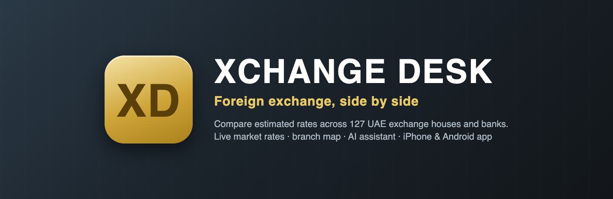
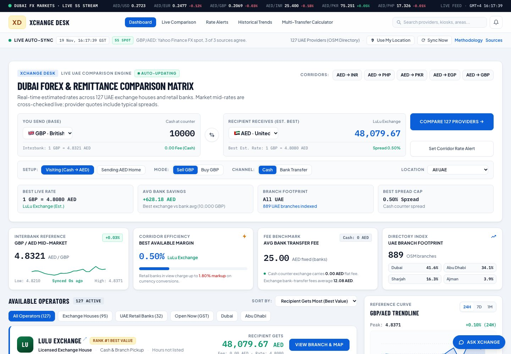
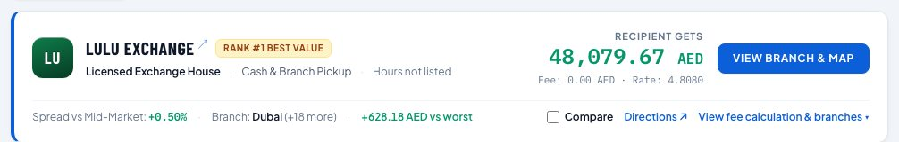
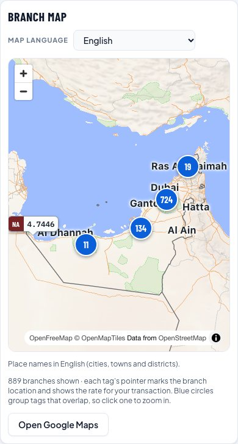
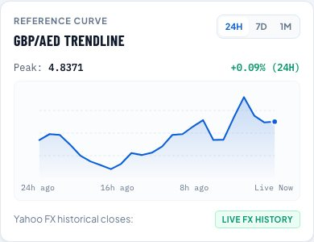
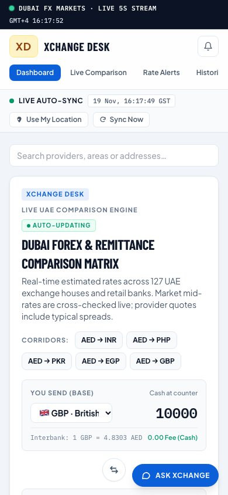
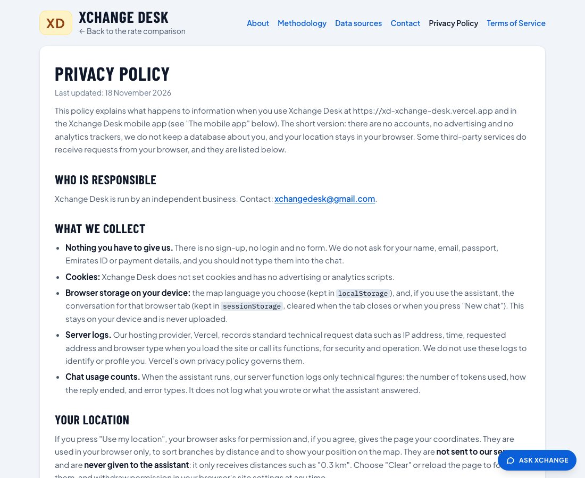
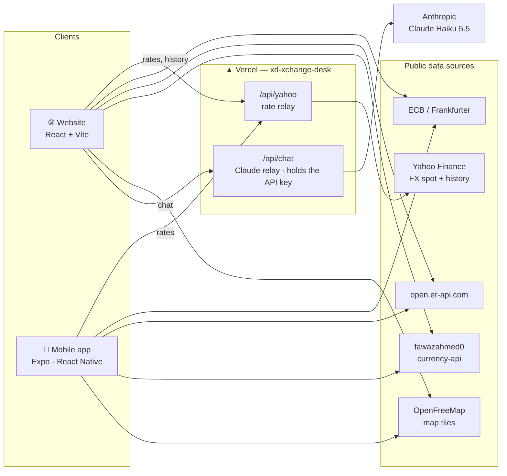
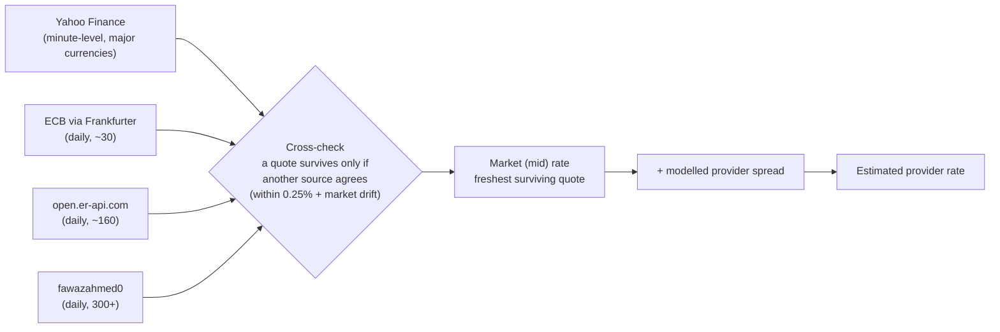

<div align="center">



<br/>

**Compare estimated money-exchange rates across every major exchange house and bank in the UAE — on the web, on iPhone and on Android.**

<br/>

[](https://xd-xchange-desk.vercel.app)
[](https://vercel.com/veri-talent/xd-xchange-desk)
[](mobile/)


</div>

---

## Contents

- [Quick links](#-quick-links)
- [What it is](#-what-it-is)
- [Screenshots](#-screenshots)
- [Features](#-features)
- [How it works](#-how-it-works)
- [Where the numbers come from](#-where-the-numbers-come-from)
- [How a provider's rate is estimated](#-how-a-providers-rate-is-estimated)
- [The AI assistant](#-the-ai-assistant-ask-xchange)
- [Run the website locally](#-run-the-website-locally)
- [Configuration](#-configuration)
- [Deploy to Vercel](#-deploy-to-vercel)
- [The mobile app](#-the-mobile-app)
- [Project structure](#-project-structure)
- [Privacy and security](#-privacy-and-security)
- [Status and honest limitations](#-status-and-honest-limitations)
- [Roadmap](#-roadmap)
- [Credits and data licences](#-credits-and-data-licences)
- [Disclaimer](#-disclaimer)

---

## 🔗 Quick links

| What | Where |
| --- | --- |
| 🌐 **Website** | **<https://xd-xchange-desk.vercel.app>** |
| ▲ **Vercel project** (hosting, deployments, environment variables) | <https://vercel.com/veri-talent/xd-xchange-desk> |
| 💻 **GitHub repository** | <https://github.com/allnewrup/Xchange-Desk-Foreign-Exchange> |
| 📱 **Mobile app builds** (Expo / EAS) | <https://expo.dev/accounts/xchangedesk/projects/xchange-desk> |
| 🗄️ **Database** | **None.** The site has no database and no user accounts, so there is no Supabase (or any other database) behind it. Hosting is Vercel only. |
| ✉️ **Contact** | [xchangedesk@gmail.com](mailto:xchangedesk@gmail.com) |

> The earlier address `dxb-fx-compare.vercel.app` no longer exists. Use the link above.

---

## 💡 What it is

**Xchange Desk** lines up UAE exchange houses and banks the way a flight-search site lines up airlines: one search, quick filters, sortable cards, a map, and an AI assistant that can operate the page for you.

- **127 providers and about 890 branches** across all seven emirates (95 exchange houses and 32 banks), including Al Ansari, Al Fardan, LuLu, Al Rostamani, Joyalukkas, Orient, Emirates NBD, FAB, ADCB, Mashreq and more.
- **Live market rates**, cross-checked across four independent public feeds.
- **Provider rates are clearly labelled estimates** (market rate plus a modelled spread). Exchange houses do not publish live rates, and the site never pretends otherwise.
- **No accounts, no ads, no analytics trackers, no database.**
- Independent: not affiliated with any provider it lists.

This repository holds **both products**:

| Folder | What | Stack |
| --- | --- | --- |
| [`/`](.) (repository root) | The website and its two serverless functions | React 19 · Vite 8 · Tailwind 3 · MapLibre GL · Vercel Functions |
| [`/mobile`](mobile) | The iPhone and Android app | Expo SDK 58 · React Native 0.88 · MapLibre Native |

---

## 📸 Screenshots

<div align="center">

**Dashboard**



<br/><br/>

**Provider cards** — the name links to the company's official website



<br/><br/>

<table>
  <tr>
    <td align="center" width="50%"><b>Branch map</b><br/></td>
    <td align="center" width="50%"><b>Real rate history</b><br/></td>
  </tr>
  <tr>
    <td align="center" width="50%"><b>On a phone screen</b><br/></td>
    <td align="center" width="50%"><b>The mobile app icon</b><br/></td>
  </tr>
</table>

<br/>

**Privacy policy page**



</div>

---

## ✨ Features

### 🌐 Website

| Area | What you get |
| --- | --- |
| **Dashboard** | Live ticker for six corridors, a comparison matrix (currency pair, amount, sell/buy, cash/bank, area), and KPI tiles: interbank reference, best available margin, average bank transfer fee, branch footprint. |
| **Live comparison** | Sortable provider cards with estimated Sell and Buy rates, total received or paid, fee, open/closed now (UAE time), nearest branch, and savings against the worst offer. Filters for exchange houses, banks, open now, and emirate. |
| **Side-by-side tray** | Tick 2 to 4 providers and compare them in a pinned table. **Export the comparison to CSV.** |
| **Rate alerts** | Set a target rate for a pair. When the live market rate crosses it, the page highlights the alert. Alerts are saved **in your browser only** and are checked **while the page is open**. |
| **Historical trends** | 24 hour, 7 day and 1 month charts built from **real Yahoo Finance closes**. If the feed has nothing for a pair, the chart says so instead of drawing a made-up line. |
| **Multi-transfer calculator** | Shows what you pay in fees if you split a remittance into several smaller transfers instead of sending it once. |
| **Spread transparency meter** | How far each category (profiled exchange houses, other exchange houses, banks) typically sits from the mid-market rate. |
| **Branch map** | MapLibre vector map on OpenFreeMap tiles. Every branch is a tag showing the provider and its rate; nearby tags group into numbered circles. Map labels in English, Arabic, Bengali, Tamil, Malayalam, Hindi or Urdu. "Use my location" shows the three nearest branches. |
| **Directions & reviews** | One tap to Google Maps directions, or to a provider's reviews on Google. Ratings and reviews are **never invented or shown** (see [limitations](#-status-and-honest-limitations)). |
| **Official website links** | 28 well-known providers link to their official site (hand-checked on 18 Nov 2026); everything unconfirmed stays plain text. |
| **Ask Xchange** | A Claude-powered assistant that answers questions **and** operates the page. [Details below.](#-the-ai-assistant-ask-xchange) |
| **Information pages** | About, Methodology, Data sources (with live update times), Contact, Privacy Policy, Terms of Service. |
| **Keyboard shortcuts** | `/` focus search · `r` refresh rates · `s` swap currencies. |
| **Accessible** | Native controls, visible focus rings, ARIA states, reduced-motion support, works down to phone width. |

### 📱 Mobile app (iPhone and Android)

- **Compare** tab: 203 currencies (searchable), amount, sell/buy, cash/bank, area, filters, "Near me", pull-to-refresh, a "Best right now" card and a live market board with its age and source agreement.
- **Map** tab: native map (MapLibre + OpenFreeMap, **no API key, no billing account**) with the matching branches; green pin is the best rate; tap a pin for details and directions.
- **Provider** screen: the estimate with the market rate, modelled spread and fee; every branch with hours and distance.
- **Saved** pairs with live rates, and an **offline mode** that shows the last known rates, clearly labelled.
- **More**: About, how rates are calculated, live data-source status, Contact, Privacy, Terms.

---

## 🧭 How it works



**Design rules that shape the code**

1. **No server-side user data.** The server functions are stateless relays. Nothing about a visitor is stored.
2. **The browser runs the tools.** When the assistant "does" something (changes the search, compares providers, flies the map), the *page* executes it against live state; the server only forwards messages. Tool inputs are validated first.
3. **Never invent a number.** Every figure comes from a feed or a calculation, and anything estimated says so.

---

## 📊 Where the numbers come from



| Data | Source | Status |
| --- | --- | --- |
| **Market (mid) rate** | The four feeds above, cross-checked | **Live where possible.** The UI shows the source, the quote age and how many sources agreed. Daily-only currencies are labelled "daily reference rate". On weekends the quote is the last close. |
| **Provider rates (Sell/Buy)** | Market rate + a modelled spread | **Estimated.** No exchange house publishes a rates API, so genuine counter rates cannot be collected legitimately. |
| **Providers, branches, addresses, hours** | [OpenStreetMap](https://www.openstreetmap.org) snapshot (`src/data/osm-uae.json`) | **A snapshot, not a live feed.** Can be incomplete or out of date. Refresh with `node scripts/build-osm-data.mjs`. |
| **Map background** | [OpenFreeMap](https://openfreemap.org) | Live vector tiles. |
| **Map place names** (other languages) | OpenStreetMap `name:xx` tags + Wikidata (CC0) | Snapshot. Nothing is machine-translated; a place with no name in your language shows in English. |
| **Ratings and reviews** | — | **Not shown.** There is no licensed source, and none are invented. |
| **Provider websites** | Hand-checked ([`src/data/websites.js`](src/data/websites.js)) | 28 brands, checked 18 Nov 2026. |

---

## 🧮 How a provider's rate is estimated

All the maths lives in [`src/lib/pricing.js`](src/lib/pricing.js).

```text
mid(B→T)  = ratePerAED[T] / ratePerAED[B]                  # the cross-checked market rate

spread %  = max(0.15, margin + bias[T] + 0.5·bias[B] + (bank transfer ? −0.20 : 0))
weBuy     = mid × (1 − spread%)      # you hand over B, provider buys it  → you receive this many T per B
weSell    = mid × (1 + spread%)      # you buy B from the provider        → you pay this many T per B

Sell mode:  you receive = (amount − feeBase) × weBuy
Buy mode:   you pay     = (amount + feeBase) × weSell      (feeBase is 0 for cash)
```

| Group | Typical spread | Bank-transfer fee |
| --- | --- | --- |
| 8 hand-profiled exchange houses | 0.50 – 0.80 % (per provider and currency) | AED 10 – 16 |
| Every other exchange house | 0.65 % (one category average) | AED 12 |
| Banks | 1.8 % (one category average) | AED 25 |
| Paying by bank transfer instead of cash | spread 0.2 percentage points tighter | the flat fee above |

> ⚠️ These spreads are **modelled by Xchange Desk, not measured or supplied by the providers**. Providers in the same category show the same figure. Always confirm the real rate and fees at the counter.

---

## 🤖 The AI assistant (Ask Xchange)

A floating **Ask Xchange** button opens a chat that can *operate the page*:

> *"Best rate for 1,000 USD to AED near Deira, open now"* · *"Compare the top three"* · *"Banks open now in Sharjah"* · *"Closest to me"* · *"What should I bring?"*

It replies in the user's language and works with these tools, all of which run **in the browser** against live page state:

| Tool | What it does |
| --- | --- |
| `update_search` | Changes currencies, amount, mode, channel, area, filters or sort, then returns the top matches |
| `get_results` | Reads the providers currently shown |
| `get_provider_details` | Branches, hours and how a provider's rate is estimated |
| `compare_providers` | Fills the side-by-side tray with 2 to 4 providers |
| `show_on_map` | Selects a provider and flies the map to a branch |
| `find_nearest` | Asks the browser for location (with permission), then sorts by distance |

- **Model:** Claude Haiku 5.5 (`claude-haiku-5-5`), thinking off, 1,024 output tokens per reply. Change it in [`src/lib/chatSpec.js`](src/lib/chatSpec.js).
- **No invented numbers:** every figure it states must come from a tool result; provider rates stay "estimated"; it never states a rating or review.
- **Privacy:** the conversation goes to Anthropic to produce the answer. The server keeps **no chat log**; the browser keeps the chat in `sessionStorage` for the tab only. Coordinates are never sent, only distances like "0.3 km".
- **Limits:** best-effort 40 messages per 10 minutes per visitor and 4,000 per day (configurable); the hard ceiling is the spend limit you set in the Anthropic Console.
- **Switching it on:** add `ANTHROPIC_API_KEY` (see [Configuration](#-configuration)). Without it the chat says it "isn't switched on yet" and nothing else changes.

---

## 💻 Run the website locally

**Requirements:** Node.js 18 or newer and npm.

```bash
git clone https://github.com/allnewrup/Xchange-Desk-Foreign-Exchange.git
cd Xchange-Desk-Foreign-Exchange
npm install
npm run dev
```

Open the address Vite prints (normally <http://localhost:5173>). Live rates load automatically through the built-in `/api/yahoo` proxy.

| Command | What it does |
| --- | --- |
| `npm run dev` | Dev server with hot reload, the live-rates proxy and the `/api/chat` route |
| `npm run build` | Production build into `dist/` |
| `npm run preview` | Serves the production build, with the same proxy |
| `npm test` | Runs the unit tests (dashboard metrics, multi-transfer maths, alerts, live-rate merging) |

---

## 🔧 Configuration

Copy [`.env.example`](.env.example) to `.env.local` for local work. On Vercel, add the same names in the project's **Settings → Environment Variables**.

| Variable | Required? | Purpose |
| --- | --- | --- |
| `ANTHROPIC_API_KEY` | Only for the assistant | Turns **Ask Xchange** on. **Server-side only: never prefix it with `VITE_`**, or it would be shipped to every visitor's browser. |
| `CHAT_REQUESTS_PER_10_MIN` | No (default 40) | Best-effort per-visitor limit for the assistant. |
| `CHAT_DAILY_CAP` | No (default 4000) | Best-effort daily cap across all visitors. |
| `VITE_PLACES_PROXY` | No | URL of your own Google Places proxy. Leave empty and no ratings or reviews are shown. |

Other places to customise:

| Setting | Where |
| --- | --- |
| Contact email, operator name, site URL, policy dates | [`src/data/site.js`](src/data/site.js) |
| Provider spreads, fees, currencies, areas | [`src/data/seed.js`](src/data/seed.js) |
| Official website links | [`src/data/websites.js`](src/data/websites.js) |
| Mobile-app download link (header QR button) | `APP_DOWNLOAD_URL` in [`src/components/QrBadge.jsx`](src/components/QrBadge.jsx). **It is empty on purpose, which hides the QR button.** Set it to the real store link once the app is published. |
| Assistant model, limits, system prompt | [`src/lib/chatSpec.js`](src/lib/chatSpec.js) |

---

## ▲ Deploy to Vercel

The website is a static Vite build plus two serverless functions, so it deploys to Vercel with no extra configuration.

```bash
npm install -g vercel
vercel login
vercel link              # choose the team and the xd-xchange-desk project
vercel env add ANTHROPIC_API_KEY --environment production --sensitive   # paste the key at the prompt
vercel deploy --prod
```

- [`vercel.json`](vercel.json) routes `/api/yahoo/*` to the rate relay, serves the information pages (`/about`, `/privacy`, …) from the single-page app, and gives the chat function a 30 second limit.
- [`.vercelignore`](.vercelignore) keeps the `mobile/` folder and the docs out of web deployments.
- A new environment variable only takes effect on the **next** deployment.
- Yahoo's endpoint is unofficial. For a commercial product, switch to a licensed FX data provider (see [roadmap](#-roadmap)).

---

## 📱 The mobile app

Lives in [`/mobile`](mobile). **Run every command from that folder.**

```bash
cd mobile
npm install
npx expo start
```

Scan the QR code with **Expo Go** (the native map needs a real build, so Expo Go shows a branch list in its place).

**Build installable apps in the cloud with EAS** (no Xcode or Android Studio needed):

```bash
npm install -g eas-cli
eas login
eas build -p android --profile preview      # installable .apk for testing
eas build -p android --profile production   # .aab for Google Play
eas build -p ios --profile production       # needs an Apple Developer account (US$99/year)
```

- Bundle ID / package: `com.xchangedesk.app`.
- Rates come from the website's relay (`API_BASE` in [`mobile/src/data/site.js`](mobile/src/data/site.js)), so the website must stay deployed.
- Full details, the store checklist and the privacy-label notes are in [`mobile/README.md`](mobile/README.md).

---

## 📁 Project structure

<details>
<summary><b>Click to expand the file tree</b></summary>

```text
Xchange-Desk-Foreign-Exchange/
├── README.md                     ← you are here
├── index.html                    Fonts, favicon links, root element
├── package.json                  Website dependencies and scripts
├── vite.config.js                Vite + React, the /api/yahoo proxy, a dev route for /api/chat
├── vercel.json                   Yahoo rewrite, page rewrites, chat function time limit
├── .vercelignore                 Keeps /mobile and /docs out of web deployments
├── .env.example                  ANTHROPIC_API_KEY and optional limits
├── tailwind.config.js · postcss.config.js
├── api/
│   ├── yahoo.js                  Serverless relay to Yahoo Finance (adds the headers browsers can't)
│   └── chat.js                   Serverless relay to Claude (streams SSE, holds the API key, checks origin, rate-limits)
├── public/                       Favicon (SVG + PNG), touch icon, robots.txt, sitemap.xml
├── scripts/
│   ├── build-osm-data.mjs        Rebuilds src/data/osm-uae.json from OpenStreetMap
│   └── build-map-places.mjs      Rebuilds map place names from OpenStreetMap + Wikidata
├── docs/                         README banner, screenshots, app icon
├── src/
│   ├── main.jsx · App.jsx        Entry point; state, filtering, sorting, layout, routing
│   ├── index.css                 Tailwind layers and the reusable component classes
│   ├── pages/                    About, Methodology, Sources, Contact, Privacy, Terms (+ PageShell)
│   ├── components/               HeaderNav, TopTicker, HeroMatrix, KpiStrip, OperatorFilters, ProviderCard,
│   │                             CompareTray / CompareDock, RightRail, MapPanel, RateAlertsModal,
│   │                             MultiTransferModal, ChatLauncher / ChatPanel, SyncStrip, ui (shared bits)
│   ├── data/                     seed.js (spreads, currencies, areas) · providers.js (builds the list)
│   │                             osm-uae.json (branches) · map-places.json · websites.js · site.js
│   ├── services/fxDataService.js The only module that knows where data comes from; components never call fetch
│   └── lib/                      pricing.js (all rate maths) · results.js · analytics.js (+ tests)
│                                 liveRates.js · exportCsv.js · currencies.js · router.jsx
│                                 chatSpec.js · chatTools.js · chatClient.js
└── mobile/                       The iPhone and Android app (its own package.json, README and EAS config)
    ├── App.js · app.json · eas.json
    ├── assets/                   Icons and splash
    └── src/                      screens · components · state · lib (fx, pricing, results) · data · content.js
```

</details>

---

## 🔒 Privacy and security

- **No accounts, no cookies, no ads, no analytics trackers, no database.** Saved alerts and the chat live only in your browser (`localStorage` / `sessionStorage`).
- **Location** is used in your browser (or on your phone) only, to sort by distance. It is not sent to our server and **never** given to the assistant.
- **The assistant's API key** stays on the server and is never sent to a browser. The chat function checks the request origin, validates and rebuilds every message from known shapes, and rate-limits visitors.
- **Third parties** that see a visitor's IP address (rate feeds, map tiles, fonts, Vercel, Anthropic when chatting) are listed in the in-site [Privacy Policy](https://xd-xchange-desk.vercel.app/privacy), which also covers the mobile app.
- The website's dependencies are kept current: `npm audit` reports **0 vulnerabilities** for the website (the mobile app's dependencies are audited separately).

---

## 🩺 Status and honest limitations

_Last reviewed 19 November 2026._

| Item | State |
| --- | --- |
| Website | ✅ Live at <https://xd-xchange-desk.vercel.app> |
| Rates, charts, map, alerts, calculator, CSV export | ✅ Working |
| **Ask Xchange assistant** | ⏳ Code complete and tested with mocked replies. **Not switched on in production until `ANTHROPIC_API_KEY` is added.** It has not yet been exercised against the real Claude API. |
| Android app | ✅ Installs and launches on a real phone and shows live rates. ⏳ The native map and location prompt are not yet verified on a device. |
| iPhone app | ⏳ Not built: needs an Apple Developer account. |
| Licensed FX data | ⏳ Rates use free public feeds. The Yahoo endpoint is unofficial and not licensed for commercial redistribution; replace it before a store release. |

Known limitations:

- **Provider rates are modelled, not scraped.** The market rate is accurate; the counter rate is an estimate.
- **No ratings or reviews.** There is no licensed source and none are invented. Each provider links to its reviews on Google instead.
- **Branch data is a snapshot** from OpenStreetMap: a branch may have moved, closed or changed hours, and a bank branch may not exchange currency.
- Opening hours use UAE time and ignore public holidays and Ramadan hours.
- OpenFreeMap is a donation-funded free service with no uptime guarantee; heavy traffic would need self-hosted or paid tiles.
- Only 9 unit tests so far (the analytics and live-rate maths); the interface itself is checked by hand in a browser.

---

## 🚀 Roadmap

- [ ] Add `ANTHROPIC_API_KEY` and verify the assistant against the real API
- [ ] Licensed real-time FX data source with server-side caching
- [ ] Publish the Android app (Google Play) and, with an Apple Developer account, the iPhone app; then set `APP_DOWNLOAD_URL`
- [ ] Verify the native map on real devices
- [ ] Real Google Places ratings, hours and coordinates (via your own proxy)
- [ ] Per-provider rate overrides and a "last verified at the counter" stamp
- [ ] Shareable URLs for a search (pair, amount, filters)
- [ ] Rate-alert notifications (push) in the app
- [ ] More tests: component tests for the cards and end-to-end checks

---

## 🙏 Credits and data licences

| Used for | Thanks to |
| --- | --- |
| Providers, branches, hours, place names | © [OpenStreetMap contributors](https://www.openstreetmap.org/copyright), [ODbL](https://opendatacommons.org/licenses/odbl/); [Wikidata](https://www.wikidata.org) (CC0) |
| Map tiles and style | [OpenFreeMap](https://openfreemap.org), © OpenMapTiles, data from OpenStreetMap |
| Map engine | [MapLibre GL JS](https://maplibre.org) (web) and MapLibre Native (app) |
| Market rates | Yahoo Finance (unofficial), [ECB via Frankfurter](https://frankfurter.dev), [open.er-api.com](https://www.exchangerate-api.com), [fawazahmed0/currency-api](https://github.com/fawazahmed0/exchange-api) |
| AI assistant | [Anthropic Claude](https://www.anthropic.com) |
| Hosting | [Vercel](https://vercel.com) |
| Mobile | [Expo](https://expo.dev) and React Native |

Licence: **no licence has been chosen yet.** Until one is added, all rights are reserved by the author.

---

## 📜 Disclaimer

Xchange Desk is an **independent comparison tool**. It is not an exchange house, it cannot exchange money for you, and it is not affiliated with, endorsed by or sponsored by any provider named in it. Provider names appear only to identify the businesses being compared; the monogram plates are not official logos. Rates shown are **indicative estimates, not offers**. Confirm the final rate, fees and any limits with the provider before you transact. This is not financial advice.

<div align="center">
<br/>
Xchange Desk · <a href="https://xd-xchange-desk.vercel.app">xd-xchange-desk.vercel.app</a> · <a href="mailto:xchangedesk@gmail.com">xchangedesk@gmail.com</a>
</div>
